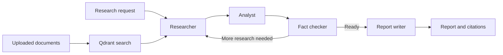

# FinResearch AI

Financial research assistant built with FastAPI, Streamlit, LangGraph, and Google Gemini. It combines market and company data with uploaded financial documents to create research reports, run document searches, and provide quick stock quotes.

[](https://www.python.org/)
[](https://fastapi.tiangolo.com/)
[](https://www.langchain.com/langgraph)
[](https://qdrant.tech/)

## Overview

The research workflow gathers available company, market, news, SEC filing, and indexed-document information; analyzes it; checks claims against the collected research; and generates a report. Results depend on available data sources and configured API credentials.



### Features

- Multi-step research pipeline orchestrated with LangGraph.
- Financial tools for stock quotes and history, company ratios, news search, SEC filings, and calculations such as DCF, CAGR, and WACC.
- Document ingestion for PDF, TXT, Markdown, and HTML files, with chunking and embeddings stored in Qdrant.
- FastAPI endpoints with interactive OpenAPI documentation.
- Streamlit interface for company research, quick quotes, document upload, and document search.
- MCP servers for financial data and document search.

## Requirements

- Python 3.11 or later
- Docker with Docker Compose (recommended for running the complete app and Qdrant)
- A Google Gemini API key for AI analysis and embeddings: [Get an API key](https://aistudio.google.com/apikey)

Finnhub and NewsAPI credentials are optional, I have used them in this project. Some tools use public or unauthenticated data sources; availability and rate limits are controlled by those providers.

## Run With Docker Compose

1. Clone the repository and enter its directory:

	```bash
	git clone https://github.com/PremGit31/finresearch-ai.git
	cd finresearch-ai
	```

2. Create a `.env` file in the project root:

	```dotenv
	GEMINI_API_KEY=your_gemini_api_key
	FINNHUB_API_KEY=
	NEWS_API_KEY=
	SEC_USER_AGENT=FinResearchAI YourName your.email@example.com
	```

	`GEMINI_API_KEY` is needed for research and document embeddings. The other values are optional; use a real contact email in `SEC_USER_AGENT` when making SEC requests.

3. Build and start the services:

	```bash
	docker compose up --build
	```

4. Open the app:

	- Streamlit UI: <http://localhost:8501>
	- API documentation: <http://localhost:8000/docs>
	- API health: <http://localhost:8000/health>
	- Qdrant dashboard: <http://localhost:6333/dashboard>

Stop the services with `docker compose down`. Qdrant data is stored in a named Docker volume and is retained when the services stop. Use `docker compose down -v` only when you intend to delete that stored data.

## Run Locally

Use this path for API development. Start Qdrant separately, then run the API from the project root.

```powershell
py -3.11 -m venv .venv
.venv\Scripts\Activate.ps1
python -m pip install -r requirements.txt
```

On macOS or Linux, activate the environment with `source .venv/bin/activate` instead. Create the `.env` file as shown above, then start Qdrant:

```bash
docker run --name finresearch-qdrant -p 6333:6333 -p 6334:6334 -d qdrant/qdrant:v1.13.2
```

Start the API:

```bash
uvicorn api.main:app --reload
```

The API is available at <http://localhost:8000>; interactive docs are at <http://localhost:8000/docs>. To stop the local Qdrant container, run `docker stop finresearch-qdrant`.

## API Examples

The API accepts a research request as JSON:

```bash
curl -X POST http://localhost:8000/research/analyze \
  -H "Content-Type: application/json" \
  -d '{"ticker":"AAPL","query":"Summarize recent performance, valuation, and key risks."}'
```

Get a quote:

```bash
curl -X POST "http://localhost:8000/research/quick-quote?ticker=AAPL"
```

Upload a document for indexing (optional metadata fields are shown):

```bash
curl -X POST http://localhost:8000/documents/upload \
  -F "file=@./data/raw/AAPL_Q4_2024_Earnings_Transcript.txt" \
  -F "company=Apple" \
  -F "document_type=earnings_transcript" \
  -F "year=2024"
```

Search indexed documents:

```bash
curl -X POST "http://localhost:8000/documents/search?query=revenue%20growth&num_results=5"
```

### Endpoints

| Method | Path | Description |
| --- | --- | --- |
| `GET` | `/` | API overview |
| `GET` | `/health` | API and dependency health |
| `POST` | `/research/analyze` | Run the multi-agent research workflow |
| `POST` | `/research/quick-quote?ticker=AAPL` | Fetch a stock quote |
| `POST` | `/documents/upload` | Upload and index a supported document |
| `GET` | `/documents/info` | Get vector-store collection information |
| `POST` | `/documents/search?query=...&num_results=5` | Search indexed documents |

## Ingest Documents From Disk

Place supported files in `data/raw/`. The repository includes sample AAPL and Microsoft documents. With Qdrant running and the Python environment configured, ingest the directory:

```bash
python scripts/ingest_documents.py
```

To ingest another directory and attach metadata:

```bash
python scripts/ingest_documents.py --directory ./my-documents --company "Example Corp" --type annual_report
```

Supported file extensions are `.pdf`, `.txt`, `.md`, `.html`, and `.htm`. Documents are chunked and embedded before being added to Qdrant.

## MCP Servers

The MCP servers use standard input/output transport. Run one server per MCP client configuration:

```bash
python -m src.mcp.financial_data_server
```

```bash
python -m src.mcp.document_search_server
```

The document search server requires Qdrant and an initialized document collection. Configure the commands in your MCP client's settings as appropriate for that client.

## Tests

Run the test suite from the project root:

```bash
pytest
```

Some tool tests call external market and news data sources, so they require network access and may be affected by provider availability or rate limits.

## Configuration

| Variable | Required | Purpose |
| --- | --- | --- |
| `GEMINI_API_KEY` | For AI features | Google Gemini API key used for analysis and embeddings |
| `FINNHUB_API_KEY` | No | Optional Finnhub data access |
| `NEWS_API_KEY` | No | Optional NewsAPI access |
| `SEC_USER_AGENT` | Recommended | Contact-identifying user agent for SEC requests |
| `QDRANT_HOST` | No | Qdrant hostname; defaults to `localhost` outside Compose |
| `QDRANT_PORT` | No | Qdrant port; defaults to `6333` |

The model names and document chunking settings are defined in `config/settings.py`.

## Disclaimer

FinResearch AI is an experimental research tool. Its output may be incomplete, delayed, or inaccurate and is not investment advice. Verify information with primary sources and consult a qualified financial professional before making investment decisions. Market data and third-party services are subject to their providers' terms, availability, and rate limits.